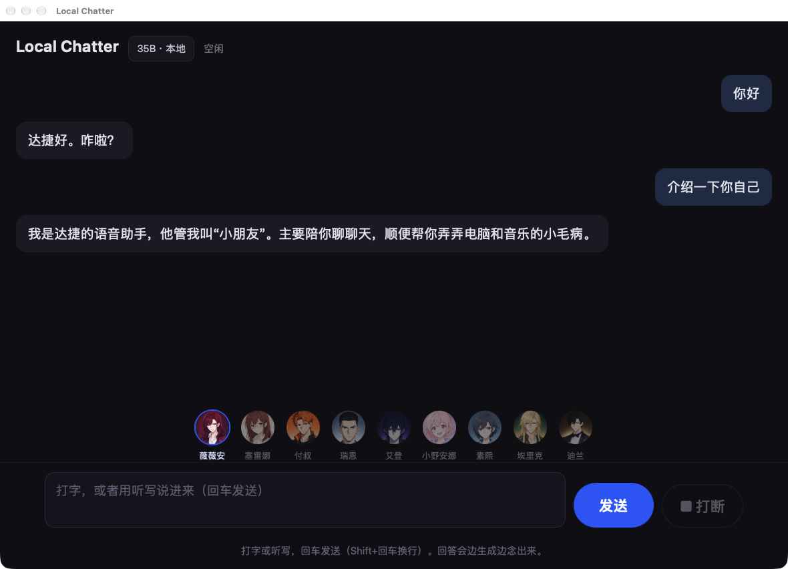

# Local Chatter

一个**完全离线**的本地聊天小窗口。

打字（或用系统听写）→ 本机模型回答 → 本机 TTS 念出来。
**不出网、不花钱、关掉就忘。**



---

## 它需要三样东西

| 要什么 | 干什么用 | 必需 |
|---|---|---|
| 一个本地模型（Ollama） | 当脑子 | ✅ |
| Qwen3-TTS 1.7B **CustomVoice** | 出声音 | ✅（要声音就得装） |
| ffmpeg | 转音频 | 可选 |

程序**不写死**用哪个模型：启动时它会问 Ollama「你本机装了哪些」，把列表给出来，你自己挑。

---

## 一、装一个适合自己电脑的本地模型

```sh
# 先装 Ollama：https://ollama.com/download

ollama pull qwen3:8b             # 大多数机器都跑得动
ollama pull qwen3:30b-a3b        # 内存大（32G+）就上这个
```

**按你自己电脑能带得动的来就行。** 8B 能打，30B 也能打，程序不挑模型。

- 大一些：懂得多、答得深，慢一点
- 小一些：快，浅

> 作者本机用的是 `qwen3.6-35b-a3b-q4:64k`（64G 内存的机器）。

启动后，界面右上角的下拉里就是 **你这台机器上装过的全部模型**，随便换，不用改代码。

---

## 二、装 Qwen3-TTS（CustomVoice）——出声音的那一半

Apple Silicon（M 系列芯片）上的 MLX 版本，模型约 3.1G。

```sh
brew install uv          # 没装 uv 的话

cd tools
uv venv .venv --python 3.11
uv pip install --python .venv/bin/python -U mlx-audio soundfile numpy

# 下模型（国内可用镜像；不加 HF_ENDPOINT 就走官方）
HF_ENDPOINT=https://hf-mirror.com .venv/bin/python - <<'PY'
from huggingface_hub import snapshot_download
snapshot_download(
    repo_id="mlx-community/Qwen3-TTS-12Hz-1.7B-CustomVoice-8bit",
    local_dir="models/qwen3tts",
)
PY
```

起服务（监听 `127.0.0.1:3910`）：

```sh
cd tools && .venv/bin/python tts_server.py
```

第一次启动要加载模型，**冷启动十几秒是正常的**；热起来一句不到一秒。

它自带九个音色，本程序那一排头像就是它们：

`vivian` 薇薇安 · `serena` 塞雷娜 · `uncle_fu` 付叔 · `ryan` 瑞恩 · `aiden` 艾登 ·
`ono_anna` 小野安娜（日语）· `sohee` 素熙（韩语）· `eric` 埃里克（四川话）· `dylan` 迪兰（北京话）

> ⚠️ 这九个是**音色**，不是语言开关。拿日语嗓念中文，会有口音——这是正常的。

---

## 三、跑起来

```sh
chmod +x start.sh
./start.sh          # 或者：bash start.sh
```

然后打开 <http://127.0.0.1:3930/>。

- **回车**发送，**Shift+回车**换行
- 想用嘴说：用你系统自带的听写（macOS 一般是双击 Control）往输入框里说，说完回车
- 点「＋ 新对话」清空，从头开始
- 头像那一排是**嗓子**，点一下就换

---

## 打包成 Mac 程序（可选）

```sh
cd mac && ./build.sh
```

产物在 `mac/build/Local Chatter.app`，双击就开，不用浏览器。

壳是 WKWebView，会自己拉起本地服务。要重画图标跑 `mac/make_icon.py`。

---

## 它有意不做的事

- **不联网。** 页面、服务、模型、嗓子全在本机。
- **不存聊天记录。** 关掉就忘，重新打开是空白的。
- **不接上下文。** 你每问一句，它只看到这一句。
- **不看图。** 它只负责说话，看图是别的东西的活。

---

## 已知的坑（都踩过）

- **麦克风在 WKWebView 里不稳。** 所以这一版把录音撤了，改成打字/听写。
- `mac/build.sh` 编译时必须带 `-module-cache-path build/ModuleCache`；
  默认缓存在 `/var/folders`，受限环境写不进去。
- 签名前要 `xattr -cr`，**而且得清两次**，否则报
  `resource fork, Finder information, or similar detritus not allowed`。
- 壳里**别在「导航失败」的回调里再加载一次**：导航被取消也算失败，
  会变成页面无限重载（看起来像崩溃）。

---

## 授权

MIT。用吧，出问题随便改。

九个音色和它们的肖像来自 Qwen3-TTS 自带的 CustomVoice 声库；
肖像是用 AI 画的，放在 `characters/`。
